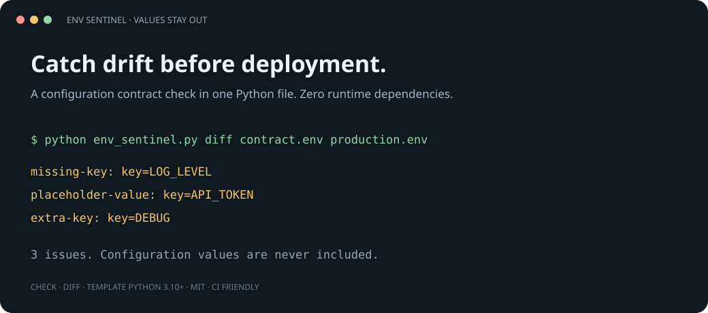

<div align="center">

# Env Sentinel

**Catch configuration drift. Keep values out of the report.**

[](https://github.com/Chanson4/env-sentinel/actions/workflows/test.yml)


[](LICENSE)

[Quick start](#quick-start) · [Examples](examples) · [中文说明](README.zh-CN.md) · [Download](https://github.com/Chanson4/env-sentinel/releases/latest)



</div>

Your staging deployment is missing `DATABASE_URL`. Production still has `API_TOKEN=changeme`. A teammate accidentally pasted configuration values into a CI report.

Env Sentinel checks the **shape and hygiene** of dotenv files. Reports contain validated key names, issue codes, reference names and line numbers. They never contain configuration values or raw source lines.

## Quick start

Requires Python 3.10+. Run the single script; no installation or third-party runtime packages needed.

```sh
git clone https://github.com/Chanson4/env-sentinel.git
cd env-sentinel
python env_sentinel.py diff examples/contract.env examples/drift.env
```

```text
missing-key: key=LOG_LEVEL
placeholder-value: key=API_TOKEN
extra-key: key=DEBUG
3 issue(s). Configuration values are never included.
```

Prefer a command on your PATH? Install from the checked-out source:

```sh
python -m pip install .
env-sentinel --help
```

The package is **not published on PyPI**. The project distribution name is `env-sentinel-lite`; the command is `env-sentinel`. Installing from source uses setuptools at build time, while running the script uses only Python's standard library.

## Three useful commands

```sh
# Syntax, duplicate keys, blank values, common placeholders and references
python env_sentinel.py check .env

# Required keys from a contract; permit environment-specific extra keys
python env_sentinel.py diff .env.example .env.production --allow-extra

# Machine-readable report; suitable for CI
python env_sentinel.py check .env --required .env.example --format json

# Safe starting point for a public template: sorted keys, all values blank
python env_sentinel.py template .env > .env.example
```

Reference values do not define expected values and may be blank. Only reference **keys** form the contract. Target values are checked for emptiness, placeholder markers and reference hygiene. `diff` deliberately does not compare actual values: changing a real token should not create configuration drift.

| Exit | Meaning |
| --- | --- |
| `0` | Checks passed / template exported |
| `1` | Configuration issues found |
| `2` | Input unavailable, invalid template source, or usage error |

## What it understands

- UTF-8 / UTF-8 BOM, CRLF, `export KEY=value` and comments.
- Single- and double-quoted values, including multiline values.
- Unquoted inline comments after whitespace; `COLOR=#fff` stays a value.
- `${KEY}`, `${KEY:-fallback}`, `${KEY-fallback}`, `${KEY:?message}` and `${KEY?message}` references.
- Undefined references and cyclic reference chains. Single-quoted / escaped references stay literal.
- Duplicate or invalid assignments, unclosed quotes and trailing content.
- Blank values and common placeholders such as `changeme`, `TODO`, `<your-token>`.

This is a **conservative dotenv linter**, not a shell or a universal dotenv interpreter. It does not execute substitutions, read the process environment, decode escape sequences or support nested `${...}` expressions. Defaults are treated as literal text. A reference resolves only against the input file. Blank target values are always reported, including values you may intentionally leave blank. Placeholders are heuristic; they cannot establish whether a credential works.

## CI example

```yaml
- uses: actions/checkout@v4
- uses: actions/setup-python@v5
  with:
    python-version: '3.12'
- run: python tools/env_sentinel.py diff .env.example .env.ci --format json
```

Copy `env_sentinel.py` into your repository's `tools/` folder first. Keep real `.env` files out of Git. Review key names before publishing a template: names can themselves contain internal project information. This tool is not a secret scanner.

## Develop

```sh
python -m unittest discover -s tests -v
```

Tests cover parser edge cases, long reference chains, CLI exit codes and value-free reports. No test dependencies.

See [CONTRIBUTING.md](CONTRIBUTING.md) for small improvements you can make. Useful next steps: optional allowed-empty keys and a pre-commit integration. Found a useful workflow? Open an issue with a **synthetic** example. If this saves you a broken deployment, a star helps others find it.

MIT © Chanson4
